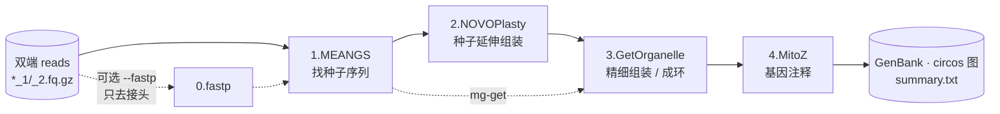

<h1 align="center">FastMitoAssembler</h1>

<p align="center">
  <b>从二代测序 reads 到注释好的线粒体基因组，一条命令完成。</b><br>
  MEANGS → NOVOPlasty → GetOrganelle → MitoZ，用 Snakemake 串联，支持批量样本和集群。
</p>

<p align="center">
  
  
  
  
  
  <a href="https://doi.org/10.3897/zse.100.127201"></a>
</p>

<p align="center">
  <a href="#安装"><b>安装</b></a> ·
  <a href="#快速开始"><b>快速开始</b></a> ·
  <a href="#命令一览">命令一览</a> ·
  <a href="#配置文件">配置文件</a> ·
  <a href="#结果目录">结果目录</a> ·
  <a href="#引用"><b>引用</b></a> ·
  <a href="#版本与开发历史">版本历史</a>
</p>



> [!NOTE]
> 当前版本 **v0.03**，在最初版本 v0.01 的基础上优化，保留原有设计和结果目录结构，原来的 `FastMitoAssembler run ...` 用法不变。遇到问题欢迎[提 issue](https://github.com/deyuanyang92-dev/FastMitoAssembler/issues)。

## 为什么是 FastMitoAssembler

**🧬 一条命令出结果。** 从 reads 到带注释的线粒体基因组：MEANGS 找种子，NOVOPlasty 延伸，GetOrganelle 再组装成环，MitoZ 注释并画图。

**🧩 可以只跑其中几步。** 只要种子、只要组装、只要注释，都有对应的命令；已有组装结果的，可以直接批量注释外部 FASTA。

**✂️ 尊重组装软件的建议。** NOVOPlasty 和 GetOrganelle 的作者都建议不要对 reads 做质量修剪。可选的 fastp 步骤只去接头（`-Q -L`），默认关闭。

**🖥️ 批量和集群友好。** 基于 Snakemake：断点续跑、多样本并行，通过 `options.yaml` 一行配置投递到 SGE 等集群。

## 安装

```bash
# 1. 创建 conda 环境（推荐 mamba，更快）
conda install mamba -c conda-forge -y
mamba env create -f environment.yml
conda activate FastMitoAssembler

# 2. 安装 FastMitoAssembler v0.03
python -m pip install git+https://github.com/deyuanyang92-dev/FastMitoAssembler.git@v0.03

# 3. 准备数据库
fma prepare ncbitaxa                 # ete3.NCBITaxa，自动下载 taxdump.tar.gz
fma prepare organelle -a animal_mt   # GetOrganelle 数据库；--list 查看已配置
```

<details>
<summary>手动安装各个软件</summary>

```bash
conda config --add channels yccscucib
conda config --add channels bioconda
conda config --add channels conda-forge

mamba create -n FastMitoAssembler -y python==3.9.*
mamba install -n FastMitoAssembler -y snakemake NOVOPlasty GetOrganelle spades blast mitoz seqkit meangs fastp click jinja2 pyyaml

conda activate FastMitoAssembler
python -m pip install genbank
```
</details>

`fma` 是 `FastMitoAssembler` 的简写，两个命令完全相同。

## 快速开始

准备 `config.yaml`（完整模板见 `fma --help` 末尾的 Configfile 路径）：

```yaml
reads_dir: '../data/'
samples: ['S1', 'S2']
fq_path_pattern: '{sample}/{sample}_1.clean.fq.gz'   # R1 相对 reads_dir 的路径，R2 自动推导
```

```bash
fma run --configfile config.yaml --dryrun   # 先预览要运行的步骤
fma run --configfile config.yaml --cores 8  # 一键运行
```

## 命令一览

所有命令共用 `run` 的参数（`--reads_dir`、`--samples`、`--configfile`、`--cores`、`--dryrun` 等）。

| 命令 | 流程 | 说明 |
|---|---|---|
| `fma run` | MEANGS → NOVOPlasty → GetOrganelle → MitoZ | 一键完整流程 |
| `fma meangs` | MEANGS | 只找种子序列 |
| `fma mg-get` | MEANGS → GetOrganelle | MEANGS 结果作为 GetOrganelle 种子 |
| `fma mg-nov-get` | MEANGS → NOVOPlasty → GetOrganelle | 只组装，不注释 |
| `fma getorganelle` | GetOrganelle | 批量组装；默认不用种子，`--seed_input seed.fasta` 指定种子 |
| `fma mitoz` | MitoZ | 批量注释；默认注释 GetOrganelle 结果，`--fasta_pattern` 注释外部 FASTA |
| `--fastp` | fastp → … | 任意命令加上，先去接头（只去接头，不做质量修剪） |

```bash
# 批量注释已有的组装结果（reads 可选，给了 --reads_dir 就一起用）
fma mitoz --samples S1 --samples S2 --fasta_pattern '/data/{sample}.fasta'

# 先去接头再跑完整流程
fma run --configfile config.yaml --fastp
```

> [!TIP]
> 同时使用 `--configfile` 时，配置文件里的值优先于命令行参数。例如要开启 fastp，请在 `config.yaml` 里写 `fastp: true`。

<details>
<summary>直接使用 Snakemake</summary>

```bash
snakemake -s /path/to/FastMitoAssembler/smk/main.smk --configfile config.yaml --cores 4 -p
# 只跑部分流程：meangs_all | getorganelle_all | mitoz_all
snakemake -s /path/to/FastMitoAssembler/smk/main.smk --configfile config.yaml --cores 4 getorganelle_all \
    --config getorganelle_seed=meangs   # novoplasty | meangs | none
```
</details>

<details>
<summary>集群（SGE）运行</summary>

```bash
mkdir -p logs/sge/
fma run --configfile config.yaml --optionfile options.yaml
```
```yaml
# options.yaml
cluster: "qsub -V -cwd -S /bin/bash -e logs/sge/ -o logs/sge/"
```
</details>

<details>
<summary>Docker</summary>

见 [docker/README.md](./docker/README.md)。注意：现有 Docker 镜像是 v0.01，不包含 v0.03 新增的命令。
</details>

## 配置文件

常用参数（全部参数见 `FastMitoAssembler/smk/config.yaml`）：

| 参数 | 默认值 | 说明 |
|---|---|---|
| `reads_dir` / `samples` | — | reads 根目录、样本名列表 |
| `fq_path_pattern` | `{sample}/{sample}_1.clean.fq.gz` | R1 路径模式 |
| `organelle_database` | `animal_mt` | GetOrganelle 数据库（`-F`） |
| `genome_min_size` / `genome_max_size` | `12000` / `22000` | NOVOPlasty 基因组大小范围 |
| `kmer_size` | `33` | NOVOPlasty k-mer |
| `clade` / `genetic_code` | `Annelida-segmented-worms` / `5` | MitoZ 类群和遗传密码表 |
| `seed_input` | — | 指定种子（.fasta / .gb），跳过 MEANGS |
| `fastp` | `false` | 是否先用 fastp 去接头 |
| `getorganelle_seed` | `novoplasty` | GetOrganelle 种子来源：`novoplasty` / `meangs` / `none` |
| `fasta_pattern` | — | MitoZ 注释外部 FASTA，如 `/data/{sample}.fasta` |

## 结果目录

`[*]` 为主要结果。

```
result/
└── S1
    ├── 0.fastp                                   # 仅 --fastp 时
    │   └── S1_1.fastp.fq.gz / S1_2.fastp.fq.gz
    ├── 1.MEANGS
    │   └── S1_deep_detected_mito.fas            [*] 种子序列
    ├── 2.NOVOPlasty
    │   └── S1.novoplasty.fasta                  [*]
    ├── 3.GetOrganelle
    │   └── animal_mt.get_organelle.fasta        [*] 最终组装
    └── 4.MitozAnnotate
        └── S1.animal_mt.get_organelle.fasta.result   [*] 注释、GenBank、circos 图
```

日志在 `logs/{sample}/`，每步耗时在 `benchmark/{sample}/`。

## 引用

如果 FastMitoAssembler 对你的研究有帮助，请引用：

> Yang D, Zeng S, Wang Z, Zhang Y, Yang D, Glasby CJ, Hwang J-S, Cai L (2024) Molecular systematics of *Perinereis* and an investigation of the status and relationships of the cultured species *Perinereis wilsoni* Glasby & Hsieh, 2006 (Annelida, Nereididae). *Zoosystematics and Evolution* 100(4): 1297–1314. https://doi.org/10.3897/zse.100.127201

同时请引用流程中用到的软件：
[MEANGS](https://github.com/YanCCscu/meangs) ·
[NOVOPlasty](https://github.com/Edith1715/NOVOplasty) ·
[GetOrganelle](https://github.com/Kinggerm/GetOrganelle) ·
[SPAdes](https://github.com/ablab/spades) ·
[MitoZ](https://github.com/linzhi2013/MitoZ) ·
[NCBI BLAST](https://blast.ncbi.nlm.nih.gov/doc/blast-help/downloadblastdata.html) ·
[SeqKit](https://github.com/shenwei356/seqkit) ·
[fastp](https://github.com/OpenGene/fastp)（使用 `--fastp` 时）

## 版本与开发历史

| 版本 | 说明 |
|---|---|
| [v0.01](https://github.com/deyuanyang92-dev/FastMitoAssembler/tree/v0.01) | 最初版本，委托诺禾（Novogene）生信工程师付费编写 |
| [v0.02](https://github.com/deyuanyang92-dev/FastMitoAssembler/tree/v0.02) | 由 Claude Code 接管后的双后端版本（存档） |
| **v0.03**（当前） | 由 Claude Code 在 v0.01 基础上优化：拆分子流程、可选 fastp 去接头、批量 GetOrganelle / MitoZ |

## 许可

[MIT](https://opensource.org/licenses/MIT)
